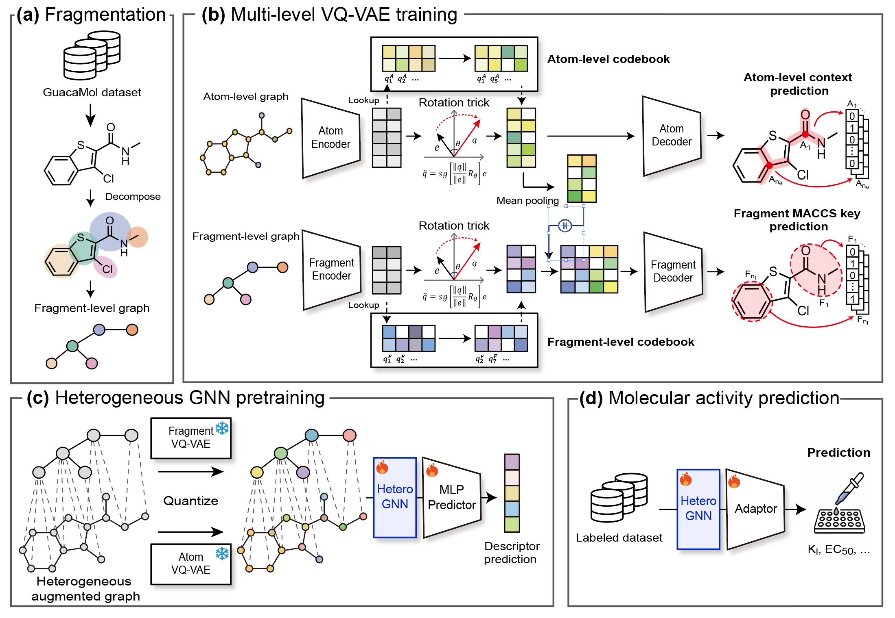

# MolVQ

## Information

Official repository of the **MolVQ** (**Learning hierarchical molecular representations via multi-level vector quantization for molecular activity prediction**)

Yewon Shin, Minsu Park, Seungju Ha, and Hojung Nam

Contact Info:
yewon.shin@gm.gist.ac.kr  
hojungnam@yonsei.ac.kr

MolVQ learns hierarchical molecular representations by combining atom- and fragment-level discrete codebooks with a heterogeneous graph encoder.

- **Purpose:** Molecular activity prediction, with particular emphasis on activity cliff compounds.
- **Pre-training:** Multi-level VQ-VAE pretraining followed by heterogeneous graph encoder pretraining on GuacaMol molecules.
- **Downstream applications:** Molecular activity prediction (Regression) and molecular property prediction (Classification).


## Overview
 

<br />

## Environment setup

<!-- TODO: Specify the tested Python version, dependencies, and CUDA version. -->

Create the environment and install the required dependencies:

```bash
# Create conda environment
conda create -n MolVQ python=3.12.14

# Activate environment 
conda activate MolVQ

# Install required packages
pip install -r requirement.txt --extra-index-url -f https://data.pyg.org/whl/torch-2.4.0+cu121.html
-f https://data.dgl.ai/wheels/torch-2.4/cu121/repo.html

```

<br />

## Repository structure

<!-- TODO: Replace the placeholders with the actual repository paths. -->

- `dataset/`: csv files for pretraining and fine-tuning.
  - **Pretraining:** GuacaMol, containing 1,591,377 unique molecules after standardization and deduplication.
  - **Molecular activity prediction:** MoleculeACE datasets covering 30 macromolecular targets. Evaluation uses both the full test set and the activity cliff subset.
  - **Molecular property prediction:** BACE, BBBP, ClinTox, HIV, SIDER, Tox21, AMES, and hERG.
- `model/`: .py files for Multi-level VQ-VAE and heterogeneous graph encoder pretraining.
- `vocab/`: Atom-level context label vocab file and fragment vocab file for GuacaMol. 
- `pretrained_model/`: Pretrained model weights for VQ-VAE and Heterogeneous graph encoder.
- `utils/`: .py files for molecular standardization, fragmentation, graph construction, data splitting, and training schedulers.


<br />

## Data preparation

- construct_vocab.ipynb : Jupyther notebook file to standardize molecular SMILES and construct atom- and fragment-level graphs using the ReLMole fragmentation rule
- construct_dataset.ipynb: Jupyter notebook file to construct the heterogeneous augmented graph dataset using the ReLMole fragmentation rule
  - Processing large SMILES datasets (e.g., GuacaMol) can be time-consuming. To pretrain the VQ-VAE or the heterogeneous graph encoder from scratch, you can download the preprocessed dataset using the Google Drive link below.
    You must unpack this tar.gz file in the repository folder.
    https://drive.google.com/file/d/1P0rDrKG2zHztSMNolo7j7JqXLlbYuhd6/view?usp=sharing


<br />

## Pre-training

### Stage 1: Multi-level VQ-VAE

Learn atom- and fragment-level codebooks through 1-hop atom-context prediction and fragment MACCS key reconstruction, respectively. Vector quantization uses the rotation trick and exponential moving average updates.

```bash
python VQ_train.py --load_data_path [DATASET_PATH]
```

### Stage 2: Heterogeneous graph encoder

Initialize atom and fragment nodes with their pretrained codebook vectors, and connect each fragment to its constituent atoms. Keep the VQ-VAEs frozen and pretrain the heterogeneous graph encoder to predict normalized RDKit molecular descriptors.

```bash
python HeteroGNN_pretrain.py --load_data_path [DATASET_PATH]
```

<!-- TODO: Specify checkpoint locations and how to load the Stage 1 models. -->

<br />

## Fine-tuning

Transfer the pretrained heterogeneous graph encoder and attach an MLP prediction head. Update the encoder and prediction head while keeping the pretrained codebooks frozen.

### Molecular activity prediction

Fine-tune on individual MoleculeACE targets for molecular activity regression.

```bash
python MoleculeACE_finetune.py --dataset [DATASET_NAME]
```

Fine-tune whole target dataset in MoleculeACE benchmark
- 30 macromolecular targets
```bash
Whole_MoleculeACE_finetune.sh
```

### Molecular property prediction

Fine-tune on the downstream molecular property classification datasets.

```bash
python MPP_finetune.py --dataset [DATASET_NAME]
```

Fine-tune whole dataset in Molecular property prediction
- 8 dataset: BACE, BBBP, ClinTox, SIDER, AMES, hERG, Tox21, HIV
```bash
Whole_MPP_finetune.sh
```

<br />
